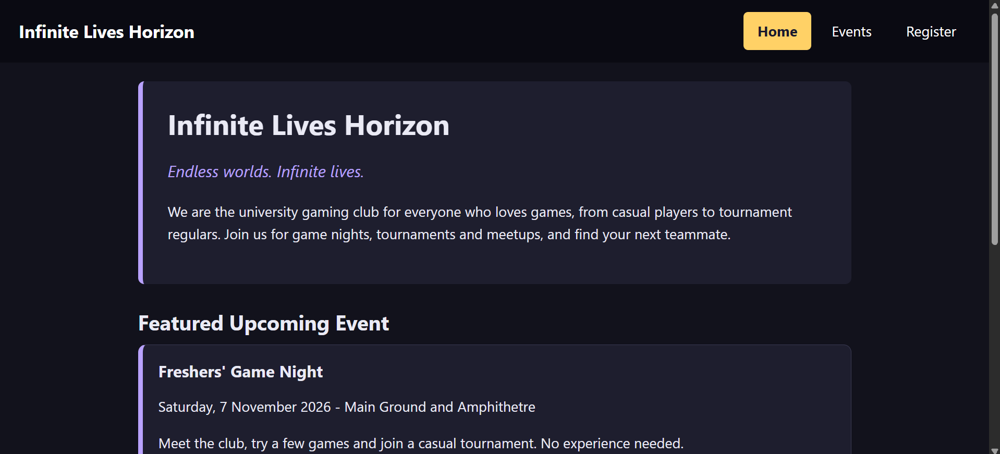

# Infinite Lives Horizon

*Endless worlds. Infinite lives.*

## About
Welcome the the **Gaming Club** of the University, where you will enjoy a lots of games, have fun, and entertain with your friends. This club is made for those students who want to interact, play games and enjoy with their friends. You can find new friends while playing games. The site is made for students who want to get knowledge about the club and resgister themselves for the next event.
Register yourselves early to GET DISCOUNT !! Seats are FCFS !1
## Pages
- `index.html`: Home page with the club description and a featured event
- `events.html`: List of upcoming events
- `register.html`: Registration form and saved registrations

## Live site
**GitHub Pages:** https://Tayyaba-tz.github.io/cit331-assignment1-24l-0035/

**Vercel:** https://infinite-lives-horizon.vercel.app/

## Run locally
1. Download or clone this repository.
2. Open the folder in VS Code.
3. Right-click `index.html` and choose "Open with Live Server" (or just open `index.html` in a browser).

## Screenshot

## Image sources
- `images/game-night.webp`: Stockcake, https://stockcake.com/i/gaming-together-night_1026378_665950

## Built with
HTML5, CSS3 and a little plain JavaScript. No frameworks or libraries.